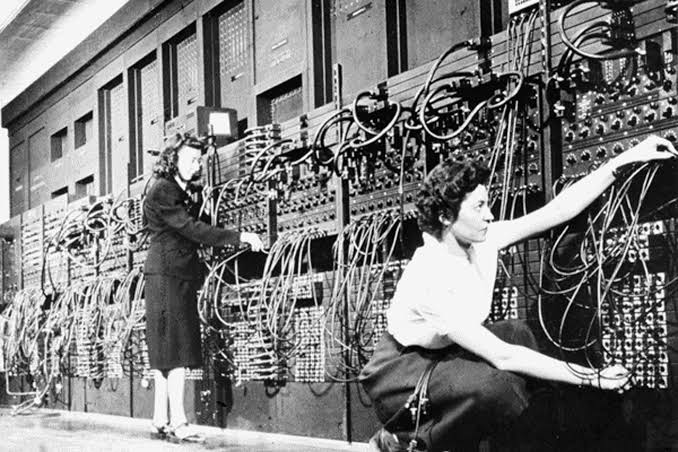
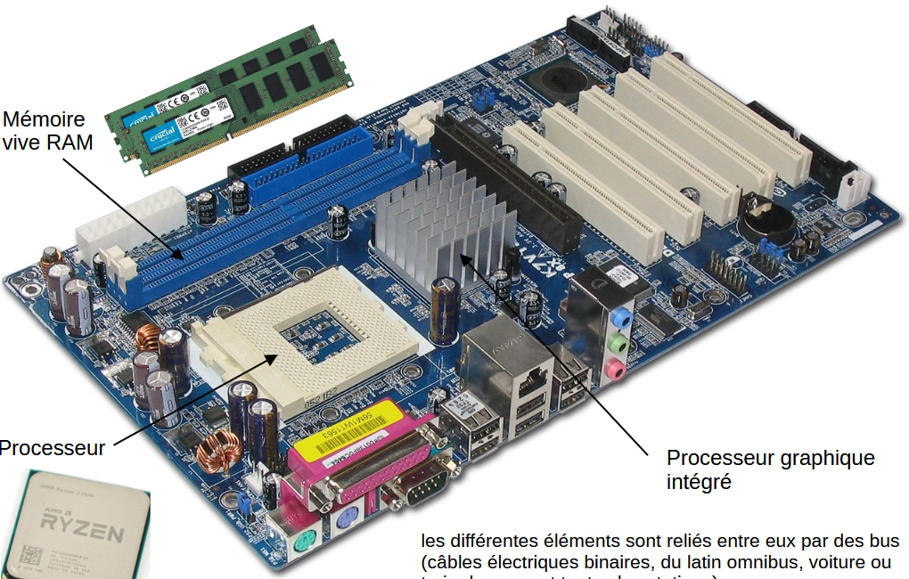
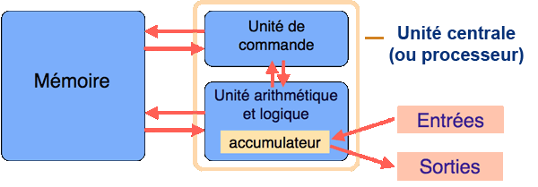
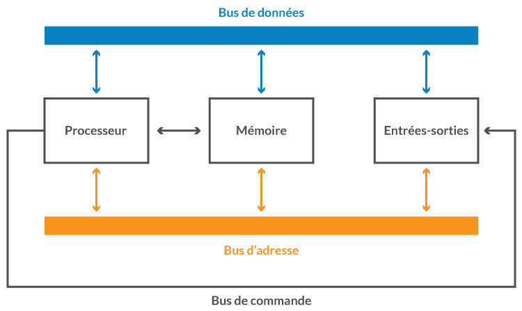

# Cours 1 — L'architecture de Von Neumann

## 1. Contexte historique : le programme enregistré

### 1.1. Les premiers ordinateurs

Les premiers ordinateurs électroniques apparaissent dans les années 1940. À cette époque, programmer une machine est une opération complexe.

Sur certaines machines, comme l'ENIAC dans sa configuration initiale, le programme est en grande partie défini par des branchements électriques, des câbles et des interrupteurs.

**Modifier le programme peut alors nécessiter de reconfigurer physiquement la machine.** L'ordinateur est ainsi fortement dépendant de la manière dont il a été configuré.

*Exemple : à l'époque, la programmation de l'ENIAC à l'aide de câbles et de panneaux de connexion.*

### 1.2. Le principe du programme enregistré

En 1945, John von Neumann contribue à la diffusion d'une nouvelle organisation des ordinateurs, notamment à travers son rapport sur le projet EDVAC (*First Draft of a Report on the EDVAC*).

L'idée fondamentale est de **stocker les instructions d'un programme dans la mémoire de l'ordinateur, au même titre que les données qu'il manipule**.

Cette approche présente plusieurs avantages :
- Un même ordinateur peut exécuter différents programmes.
- Il n'est plus nécessaire de modifier physiquement la machine pour changer de programme.
- Les programmes peuvent être stockés, copiés et modifiés comme des données.

**À retenir :** le programme devient lui-même une information stockée en mémoire. C'est le principe du *programme enregistré*, à la base de l'architecture dite **de von Neumann**.

!!! info "Un peu d'histoire"
    Le principe du programme enregistré est issu de travaux collectifs, auxquels ont notamment contribué John von Neumann, John Presper Eckert et John William Mauchly. Le rapport de von Neumann de 1945 a joué un rôle majeur dans sa diffusion.

---

## 2. L'architecture de von Neumann

L'architecture de von Neumann décrit l'organisation générale d'un ordinateur autour de plusieurs constituants qui coopèrent pour exécuter des programmes. C'est celle qui est à la base de la très grande majorité des machines actuelles.

### 2.1. Schéma général

On distingue cinq grands constituants :

| Constituant | Rôle |
|---|---|
| **Processeur(s)** | Exécute les instructions et réalise les opérations. |
| **Mémoire centrale** | Stocke les instructions et les données utilisées. |
| **Entrées** | Permettent de transmettre des informations à l'ordinateur. |
| **Sorties** | Permettent de communiquer les résultats vers l'extérieur. |
| **Bus** | Assurent les échanges d'informations entre les constituants. |

Le processeur et la mémoire centrale constituent les éléments principaux de cette architecture. Les périphériques permettent à l'ordinateur de communiquer avec son environnement.

---

## 3. Le processeur

Le **processeur** (CPU, *Central Processing Unit*) est le composant chargé d'exécuter les instructions des programmes.

### 3.1. Organisation interne

On distingue principalement trois éléments :

### 3.2. L'unité de contrôle

L'unité de contrôle (ou unité de commande) pilote l'exécution des instructions.

Elle est notamment chargée de :
- Récupérer les instructions en mémoire.
- Interpréter les instructions à exécuter.
- Coordonner les opérations réalisées par les autres composants du processeur.

### 3.3. L'unité arithmétique et logique

L'**unité arithmétique et logique (UAL)** réalise les opérations sur les données.

Elle peut notamment effectuer :
- Des opérations arithmétiques : addition, soustraction, etc.
- Des opérations logiques : ET, OU, NON, comparaisons, etc.

*Exemple :* lorsqu'un programme demande de calculer `12 + 5`, l'UAL réalise l'addition et produit le résultat `17`.

### 3.4. Les registres

Les registres sont de petites zones de mémoire très rapides situées directement dans le processeur. Ils permettent de conserver temporairement les informations nécessaires à son fonctionnement.

Certains registres ont un rôle particulier :
- Le **compteur ordinal (CO)** contient l'adresse de la prochaine instruction à exécuter.
- Le **registre accumulateur** peut contenir temporairement le résultat d'une opération ou une donnée utilisée par l'UAL.

Nous étudierons plus précisément leur rôle lors de l'exécution d'un programme.

---

## 4. La mémoire centrale

La mémoire centrale permet de stocker les instructions des programmes ainsi que les données nécessaires à leur exécution.

### 4.1. Organisation de la mémoire

La mémoire est organisée en de nombreux emplacements appelés **cellules mémoire**.

Chaque emplacement possède une adresse qui permet de le retrouver.

On peut représenter une mémoire simplifiée de la manière suivante :

| Adresse | Contenu |
|---:|---|
| 0 | `10101010` |
| 1 | `00001111` |
| 2 | `11000011` |
| 3 | `00110011` |

Dans cet exemple, chaque cellule contient un octet (8 bits).

Le processeur peut :
- **Lire** le contenu d'un emplacement mémoire précis.
- **Écrire** une nouvelle information à une adresse donnée.

Les instructions et les données occupent des emplacements de cette même mémoire.

### 4.2. Mémoire vive et stockage secondaire

Il ne faut pas confondre la mémoire centrale avec les dispositifs de stockage de l'ordinateur.

| Mémoire vive (RAM) | Stockage secondaire (SSD, HDD, ...) |
|---|---|
| Stocke temporairement les programmes et les données utilisés. | Stocke durablement les fichiers et les programmes. |
| Accès rapide aux informations. | Accès généralement beaucoup plus lent. |
| Mémoire volatile : son contenu est perdu lorsque l'alimentation est coupée. | Mémoire non volatile : les informations sont conservées sans alimentation. |

Lorsqu'un programme est lancé, il est généralement chargé depuis le stockage secondaire vers la mémoire vive afin que le processeur puisse l'utiliser.

---

## 5. Les échanges entre les composants

Les différents constituants d'un ordinateur doivent communiquer pour fonctionner ensemble.

Ces échanges sont notamment assurés par des **bus**, c'est-à-dire des ensembles de lignes de communication permettant de transporter des informations.

### 5.1. Les trois types de bus

On distingue trois principaux types de bus :

| Bus | Rôle |
|---|---|
| **Bus de données** | Transporte les instructions, les données et les résultats des opérations. |
| **Bus d'adresses** | Transporte les adresses des emplacements mémoire auxquels le processeur souhaite accéder. |
| **Bus de contrôle (ou commande)** | Transporte les signaux permettant de coordonner les échanges et les opérations. |

### 5.2. Exemple : lecture d'une donnée en mémoire

Lorsqu'un processeur souhaite récupérer une information située à l'adresse 12 :

1. Il transmet l'adresse 12 à la mémoire grâce au bus d'adresses.
2. Il indique qu'il souhaite effectuer une lecture grâce au bus de contrôle.
3. La mémoire transmet le contenu de l'adresse 12 au processeur grâce au bus de données.

Le processeur peut alors utiliser cette information pour effectuer une opération.

---

## Bilan

L'architecture de von Neumann repose sur plusieurs principes fondamentaux :

- Un processeur exécute les instructions des programmes.
- La mémoire centrale stocke les instructions et les données.
- Les instructions et les données partagent la même mémoire.
- Les périphériques permettent les échanges avec l'extérieur.
- Les bus assurent la communication entre les différents constituants.

Cette organisation constitue encore aujourd'hui un modèle fondamental pour comprendre le fonctionnement des ordinateurs.