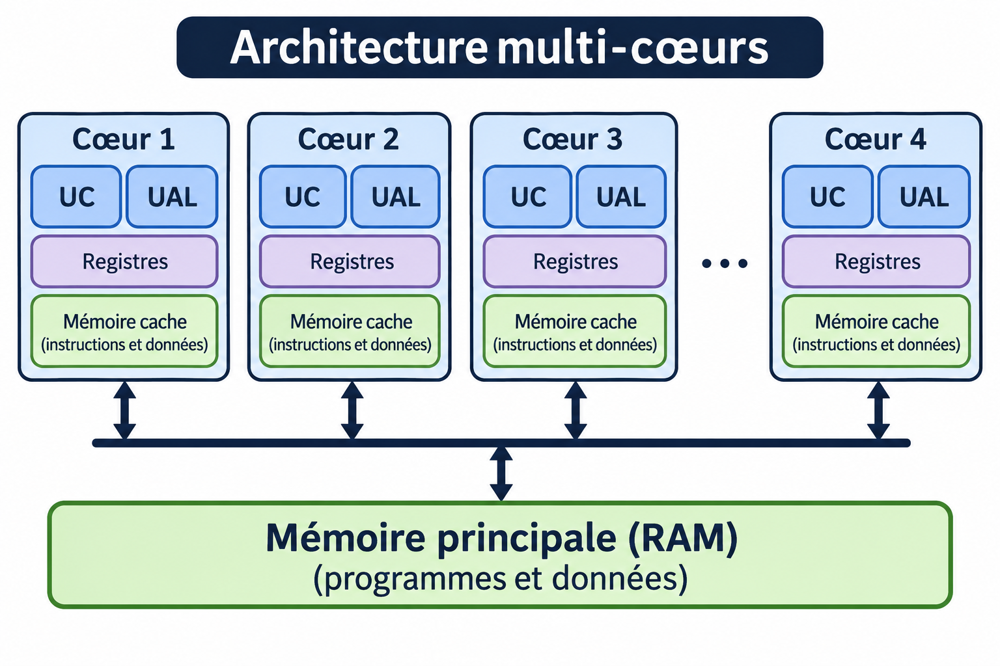

# Cours 3 (mini-cours) : Les architectures multi-processeurs et le parallélisme

## Du monocœur au multicœur

Dans les différents schémas et explications que nous avons vus jusqu'à présent, nous avions un processeur qui possède une UAL, une UC et des registres. Celui-ci travaille directement avec une mémoire RAM qui contient le programme et les données.

Mais dans la réalité, les choses sont un peu différentes, bien que l'architecture du processeur que nous avons vue existe et porte un nom : processeur monocœur. C'est aujourd'hui loin d'être la norme, car les processeurs actuels sont majoritairement des *processeurs multicœurs*.

Pour autant, vous allez vite comprendre que la différence dans l'architecture n'est pas si grande et que les schémas que nous avons vus sont amplement suffisants pour comprendre leur fonctionnement.

## Schéma du processeur multicœur

Comme son nom l'indique, un processeur multicœur possède plusieurs cœurs. Il faut donc s'intéresser à ce qu'est réellement un « cœur ».

En réalité, dans le modèle simplifié que nous étudions, un cœur ressemble à un processeur tel que vous le connaissez déjà : une UAL, une UC et des registres. La différence réside dans le fait qu'au lieu d'en avoir un seul, il y en a plusieurs en parallèle :

Ces différents cœurs travaillent tous avec une même mémoire commune : la RAM que vous connaissez bien. Chacun d'entre eux possède également une petite mémoire cache lui permettant de stocker temporairement des données et des instructions afin d'accélérer certains traitements.

Les cœurs peuvent ainsi accéder aux mêmes programmes et aux mêmes données en mémoire, tout en disposant de leurs propres registres et de leurs propres unités de traitement.

## L'intérêt du multicœur : le parallélisme

Une telle architecture possède d'énormes avantages. En effet, avoir plusieurs cœurs et donc plusieurs UAL permet de faire plusieurs calculs **en même temps**. Comme ces calculs sont effectués en parallèle, on parle de **parallélisme**.

Chaque cœur possède sa propre UC et ses propres registres. Il peut donc exécuter ses propres instructions indépendamment des autres cœurs. Attention cependant : certains calculs peuvent dépendre les uns des autres, ce qui peut empêcher leur exécution simultanée.

### Un petit exemple :

Prenons un programme qui doit effectuer quatre calculs indépendants :

- Calcul A
- Calcul B
- Calcul C
- Calcul D

Avec un seul cœur, les calculs sont exécutés successivement.

Avec deux cœurs, on peut répartir le travail :

- Le cœur 1 effectue le calcul A puis ensuite le B.

- Le cœur 2 effectue en parallèle du premier le calcul C puis ensuite le D.

On a donc mis deux fois moins de temps à exécuter notre programme, à condition que les quatre calculs prennent le même temps et que leur répartition ne génère aucun surcoût.

Si on avait eu 4 cœurs, on aurait pu tout faire en même temps, chaque cœur s'occupant d'un calcul.

Aujourd'hui, une machine classique ou gaming possède généralement entre 4 et 16 cœurs, parfois davantage. Les serveurs peuvent en posséder beaucoup plus, et les supercalculateurs regroupent des milliers, voire des millions de cœurs de calcul.

## Les limites du parallélisme

Attention, avoir plusieurs cœurs ne signifie pas que tous les programmes seront automatiquement exécutés plus rapidement !

Pour pouvoir profiter du parallélisme, il faut que le travail puisse être réparti en plusieurs tâches suffisamment indépendantes.

Prenons un autre exemple :

- Calcul A : calculer $12+8$ .

- Calcul B : multiplier le résultat de A par 3.

- Calcul C : soustraire 7 au résultat de B.

- Calcul D : diviser le résultat de C par 5.

Ici, chaque calcul dépend du résultat du précédent. Il est donc impossible de les effectuer simultanément : il faut attendre que A soit terminé pour commencer B, puis attendre B pour commencer C, etc.

D'autres difficultés peuvent également limiter les performances :

- La répartition du travail entre les différents cœurs nécessite une organisation.

- Les cœurs peuvent avoir besoin d'échanger des informations ou d'attendre des données.

- Plusieurs cœurs peuvent chercher à accéder aux mêmes ressources.

Ainsi, ajouter des cœurs ne permet pas systématiquement de multiplier les performances. Le gain dépend principalement de la capacité du programme à être découpé en tâches pouvant être exécutées en parallèle. Vous étudierez ça l'an prochain avec les systèmes d'exploitation car ce sont eux qui gèrent cette partie.

**À retenir :** le multicœur permet d'exécuter plusieurs tâches simultanément, mais tous les programmes ne peuvent pas profiter pleinement de cette possibilité.